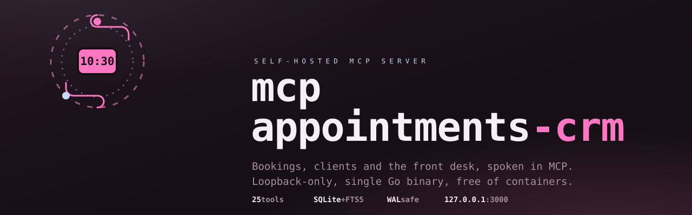

# MCP Appointments CRM

<div align="center">



<a href="https://github.com/Gentleman-Programming/gentle-ai">
  
</a>

</div>

A high-performance, self-hosted, lightweight **MCP (Model Context Protocol) server**
for business bookings and CRM. Written in **Go**, backed by **SQLite** with FTS5.
Runs natively on **Linux** and **macOS** — no containers, no external services.
Windows is supported via **WSL2** (see the Windows install note below).

## Status

🚧 **Pre-alpha** — under active development, but in a steady delivery cadence:
all five planned phases are phase history
([PRD §7 — Roadmap y Fases](./docs/PRD.md)) — db-layer, mcp-server-core,
mcp-server-advanced, install-prompts and install-and-service were each closed
behind a merged, review-gated change — and work now runs as **continuous
support & improvements** (installer/uninstall hardening, channel contracts,
release automation), not as a next numbered phase.

- **Server capability**: 25 MCP tools covering the booking flow, client
  self-registration (`register_client`, anonymous seam), business/
  profile/clients/services queries, owner-only maintenance and hours
  exceptions (auth via `X-Caller-Id` + RBAC). Full catalog: `docs/PRD.md` §3
  / `docs/SDD.md`.
- **Latest release**: v0.11.2 (2026-11-06) — assets and install steps:
  [Quickstart](#quickstart) / [`docs/installation.md`](./docs/installation.md).
- **Platform covenant**: Linux + macOS native; Windows via **WSL2**
  (systemd-enabled). Native Windows install automation is out of scope
  (owner decision 2026-11-01).
- **Agent pairing**: the clean, standard install pairs with **Hermes**
  ([hermes-agent.nousresearch.com](https://hermes-agent.nousresearch.com/) —
  the only first-class-supported agent; install it per its own docs; this
  repo configures it to talk to the MCP server, it does not install or pin
  the runtime)
  (see [`docs/gateway-contract.md`](./docs/gateway-contract.md)); any other
  MCP-capable agent connects via the
  [agent connector guide](./docs/installation.md#conectar-tu-agente-mcp-hermes-u-otros).

## Quickstart

> **Deployment target: a Linux/macOS server — a VPS or an always-on local
> machine that stays up 24/7.** The MCP service registers user-level
> (systemd `--user` + linger on Linux, launchd on macOS), so it survives
> logouts and boots, and the Hermes gateway is expected as its same-host
> always-on neighbor: the pair is a 24/7 front desk, not a laptop app
> (suspend kills availability; Windows = WSL2 on a host that boots into
> WSL — see the Windows note below).

### Install — Linux / macOS

**Paso 1 — Interactive wizard (requires a TTY):**

```bash
# download and run the setup wizard in a terminal
curl -fsSLO https://raw.githubusercontent.com/egkike/mcp-appointments-crm/main/scripts/install.sh && bash install.sh
```

**Paso 2 — Pinned deploy (requires the 3 setup JSONs generated by Paso 1):**

```bash
# pinned version (required — see note below)
curl -fsSL https://raw.githubusercontent.com/egkike/mcp-appointments-crm/main/scripts/install.sh | bash -s -- --version v0.11.2
```

> The pipe (`curl | bash`) works only for Paso 2; Paso 1 must run in a real terminal. See
> [docs/installation.md](./docs/installation.md) for the full walkthrough.
>
> **Branch A (another channel agent already runs on this host):** if a Hermes
> WhatsApp/Telegram bridge already binds the default `3000`, pass the port
> hygiene up front — `MCP_PORT=3001` (exported values are persisted into a new
> `.env`) or the agent's `bridge_port` lever. The installer pre-flights the
> MCP port before starting the service and aborts early naming both levers
> (see [installation.md — Paso 0](./docs/installation.md#paso-0--el-flujo-completo-receta-recomendada)).
>
> **Pinning is mandatory in Paso 2.** The installer does not resolve `latest`: `--version`
> must receive an exact tag (`vMAJOR.MINOR.PATCH`) and rejects `latest` and pre-releases.
> Invoked by pipe without `--version`, it falls through to the interactive wizard, which
> needs a real terminal — a piped invocation has no TTY, so it prints
> `Error: el modo interactivo requiere una terminal.` and exits 1.
>
> **Updating: re-run Paso 2 with the newer tag** (e.g. `--version v0.11.2`). The pinned
> deploy is idempotent — it swaps the binary and restarts the service while preserving
> the database, `caller-id`, setup files and the Hermes entry. Paso 1 (wizard) is only
> needed on a first-time install. *(Idempotent re-run verified 2026-09-26.)*

Installs the prebuilt binary from GitHub Releases, verifies SHA256, registers a
user-level service (`systemd --user` on Linux, `launchd` on macOS), enables linger
on Linux, and verifies the installed binary (`mcp-server --version` matches the
requested tag) plus that the user service is active. The installer itself issues no
HTTP request; the liveness probe is `http://127.0.0.1:3000/healthz` (a bare `GET /mcp`
answers **405 by design** — the MCP endpoint accepts POST JSON-RPC only). The port
is a documented default (`MCP_PORT` in the install `.env`), not a hardcode: on
hosts that will also run the Hermes WhatsApp channel, set `MCP_PORT=3001` before
the first start (see `docs/installation.md`, Paso 2 recommendation) so the MCP
and the Hermes WhatsApp bridge (also defaulting to 3000) never collide.

It runs a standard MCP server (Streamable HTTP, POST-only `/mcp`) with a
single non-standard surface: the per-request `X-Caller-Id` identity header.
The **clean, standard, product-supported installation is with Hermes**
(gateway-contract: channels + receptionist skill); **any other MCP-capable
agent (Claude Code, OpenClaw, OpenCode, IDEs) can connect** — see the
agent connector guide in `docs/installation.md` (§ “Conectar tu agente MCP
(Hermes u otros)”, con snippets verificados para cada client).

> **macOS note:** the installer's macOS path is implemented and the published
> releases ship the `Darwin` archives since v0.4.0 (`install.sh` resolves them via
> `uname`, see [ADR-0014](./docs/architecture/0014-release-and-deploy-workflow.md)).
> It is also **verified end-to-end in CI** since 2026-11-06 (issue #173): the
> `Install macOS` job runs on macos-15 on every installer-relevant PR and merge
> commit — real `install.sh --version`, real `launchctl bootstrap` with a running
> agent PID, then bootout teardown ([PR #174](https://github.com/egkike/mcp-appointments-crm/pull/174)).
> Windows runs through **WSL2** — see the block below.

### Install — Windows

**Use WSL2.** Windows-native install automation is not supported and is
explicitly out of the product's install covenant: run the installer inside
WSL2 with `[boot] systemd=true` in `/etc/wsl.conf` — the Linux path covers it
end to end. The legacy `Windows_x86_64.zip` asset note and the NSSM manual
guidance (`setup/service/nssm-install.md`, untested in CI) reference the old
Decision 3 scope of [ADR-0014](./docs/architecture/0014-release-and-deploy-workflow.md).

> See [docs/deployment.md](./docs/deployment.md) for the full runbook (HomeLab VM
> example, verification checklist, rollback, troubleshooting) and
> [ADR-0014](./docs/architecture/0014-release-and-deploy-workflow.md) for the
> release rationale (platform matrix, checksums; the Windows asset is dropped
> per the 2026-11-01 platform covenant — T1 of `feat-install-scope-uninstall`).

### Uninstall

`scripts/uninstall.sh` reverses what the installer seeds with the reverse order
and a per-artifact verification pass. **Dry-run is the default**: without flags
it prints the full plan and writes nothing — execution requires `--apply`.
Business data (`reservas.db` + operator `backups/`) is preserved unless
`--purge-data --yes` (double-gated, fail-closed on a live runtime) is used.
Hermes entry (`--purge-hermes-entry`) is byte-clean; the skill is purged by
default with `--keep-skill` to preserve it. Full flag table and the artifact
inventory: [docs/installation.md § Desinstalación](./docs/installation.md).

## Architecture

- **Language**: Go 1.27.4 with `modernc.org/sqlite` (pure Go, no CGo)
- **Database**: SQLite with WAL mode, FTS5 full-text search, `busy_timeout=5000`
- **TUI**: [Charm Bubble Tea](https://github.com/charmbracelet/bubbletea) ecosystem
- **Transport**: MCP over Streamable HTTP (spec 2025-11-25) on `127.0.0.1:3000` (loopback only) — go-sdk v1.7.0, implemented (`feat-mcp-transport`, archived 2026-08-19)
- **Install model**: user-level (no root, no `appuser`, no Docker). XDG paths on Linux
  (`~/.local/share/`, `~/.config/`), platform-native on macOS. Windows hosts run the Linux layout inside **WSL2** (2026-11-01 platform
  covenant; the Windows-native layout once designed in
  [docs/PRD.md §3.5](./docs/PRD.md#35-affected-areas) is superseded).

## Documentation

- [Contributing](./CONTRIBUTING.md) — this repository takes **issues only** (bug and feature forms; no pull requests)
- [Docs index & language conventions](./docs/README.md) — which doc is for whom, in which language (owner decision 2026-11-01)
- [PRD](./docs/PRD.md) — Product Requirements Document (canonical source)
- [SDD](./docs/SDD.md) — original idea and analysis
- [PRD Template](./docs/common/prd-template.md) — reusable template for new PRDs
- [Architecture Decisions](./docs/architecture/) — ADRs
- [AGENTS.md](./AGENTS.md) — project conventions, coding standards, commit/PR process
- [Installation](./docs/installation.md) — from-zero install guide (wizard + install.sh)
- [Deployment](./docs/deployment.md) — releases, service registration, backup
- [Demo plan](./docs/demo-plan.md) — end-to-end demonstration script
- [Maintenance](./docs/maintenance.md) — annual support manual
- [Feature tracking (ODD)](./odd/) — `odd/tasks/<feature>.md` per feature: tasks,
  evidence, gates and merge identities

## Development

Requires Go 1.27.4+.

### Run the server locally

`go run ./cmd/mcp-server` compiles and starts the MCP server — the same
composition root that ships as the `mcp-server` binary. It imports the setup
wizard output on first boot and refuses to start without it, so launch it
against the repository's fixture JSONs and a scratch database:

```bash
MCP_SETUP_DIR=internal/config/testdata \
MCP_DB_PATH=/tmp/dev-reservas.db \
go run ./cmd/mcp-server
```

It listens on `http://127.0.0.1:3000` — `/mcp` for MCP (POST-only), `/healthz` for
liveness — and seeds `business_profile`, `professionals` and `services` from the
fixtures.

- Without `MCP_SETUP_DIR` it reads the wizard output from
  `~/.config/mcp-appointments-crm/setup/` (Linux) or
  `~/Library/Application Support/MCP Appointments CRM/setup/` (macOS). A missing
  file is fatal: `el archivo de configuración setup_business.json no existe`.
- Without `MCP_DB_PATH` it defaults to
  `~/.local/share/mcp-appointments-crm/reservas.db`, the same file the installed
  service uses. A manual run and the service therefore share one database; still,
  do not run two processes against it at once, since they contend for the SQLite
  file and the listen port.
- The seed never creates an `accounts` row, so authenticated calls are rejected
  with a JSON-RPC error (`-32000`) even while `/healthz` returns 200. Create the
  owner with `mcp-server admin tui` (seed wizard + `caller-id` file); see
  [docs/installation.md](./docs/installation.md) §3.4.

### Pre-commit pipeline

The pre-commit pipeline (see
[AGENTS.md](./AGENTS.md#pre-commit-checklist) and `openspec/config.yaml`):

```bash
go fmt ./...                     # format
go vet ./...                     # vet
golangci-lint run ./...          # lint (.golangci.yml)
go build -o /dev/null ./...      # compile
go test -v -race ./...           # test
```

Development is orchestrated with
[Gentle AI](https://github.com/Gentleman-Programming/gentle-ai): features run
through **Organic Driven Development** (ODD) — explore, classify, implement
task by task with per-task work-unit commits tracked in `odd/tasks/<feature>.md`
— and every code candidate passes a **native multi-lens review gate with a
burned receipt** (receipt-driven development). Spec deltas and history live in
`openspec/`, architectural decisions in `docs/architecture/` (ADRs).
**Judgment Day** (dual blind review) is available as an explicit owner-requested
escalation. Delivery follows ordinary repository policy: issue-first PRs, CI
green, owner squash-merge — external contributions are **issues only**, never
PRs ([`CONTRIBUTING.md`](./CONTRIBUTING.md)).

## License

MIT License — see the [LICENSE](./LICENSE) file.
